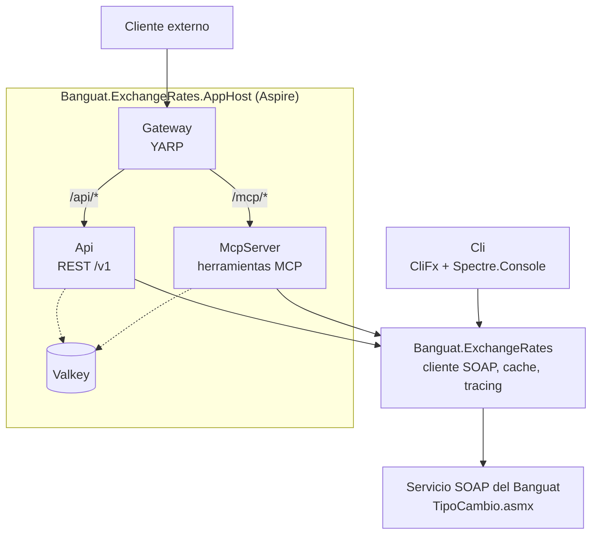

## Descripción del proyecto

Trabajar sobre tecnología vieja no tiene que salirte caro si ponés la frontera entre lo viejo y lo nuevo en el lugar correcto desde el principio. `Banguat.ExchangeRates` es un proyecto en .NET 10 que le pone una capa moderna al servicio de tipo de cambio del Banco de Guatemala, ese que corre en `TipoCambio.asmx` y que cualquiera que haya trabajado con sistemas del Estado va a reconocer al toque: SOAP puro, operaciones con nombre en español (`TipoCambioDia`, `Variables`, `TipoCambioFechaInicial`, `TipoCambioRango`) y una respuesta que cambia de forma según qué moneda le pidás. Lo que hice fue envolver ese servicio una sola vez, bien, y exponerlo de tres formas: una API REST versionada, un servidor MCP para que un agente de IA lo consulte como herramienta, y un CLI para cuando solo querés el tipo de cambio de hoy sin abrir el navegador.

Toda la parte de hablar SOAP, cachear la respuesta y trazarla con OpenTelemetry vive en un solo proyecto, `Banguat.ExchangeRates`, detrás de un cliente tipado (`IBanguatExchangeRateClient`). Ni la API, ni el CLI, ni el servidor MCP tocan XML directamente: los tres consumen el mismo cliente, así que si mejoro cómo se cachea una consulta, mejora igual en las tres puntas. Al frente de la API y del servidor MCP puse un gateway con YARP que limita cuántas peticiones aguanta cada cliente por minuto, y es el único que Aspire deja ver desde afuera.

El CLI, además, sabe enseñarse solo: trae un comando `skill install` que le deja una skill de Claude Code a un agente de IA que solo tenga el binario a mano, sin MCP ni internet para llegar a los docs del Banguat. Ese skill le explica al agente cómo manejar el CLI, y se instala junto con una tabla de alias de monedas generada al vuelo desde el mismo catálogo que el CLI usa por dentro, así que lo que el agente lee es exactamente contra lo que `--currency` resuelve.



## Tecnologías utilizadas

<div class="table-container">
  <table>
    <tr>
      <th>Capa</th>
      <th>Elección</th>
      <th>Por qué está ahí</th>
    </tr>
    <tr>
      <td><strong>Runtime</strong></td>
      <td>.NET 10</td>
      <td><code>DateOnly</code>, minimal APIs ya maduras y una base estable de <code>System.Text.Json</code>.</td>
    </tr>
    <tr>
      <td><strong>Cliente SOAP</strong></td>
      <td><code>System.Xml.Linq</code></td>
      <td>El servicio del Banguat es un ASMX viejo, sin un WSDL cómodo de consumir. Armar el sobre a mano con <code>XElement</code>/<code>XDocument</code> sale más simple que meter un generador de proxies.</td>
    </tr>
    <tr>
      <td><strong>API</strong></td>
      <td>ASP.NET Core Minimal APIs</td>
      <td>Cada endpoint es una clase que se descubre sola (<code>IEndpoint</code> + Scrutor), sin controladores ni atributos de ruta regados por todos lados.</td>
    </tr>
    <tr>
      <td><strong>Gateway</strong></td>
      <td>YARP</td>
      <td>Reverse proxy configurado en código, con transforms de ruta y destinos resueltos por service discovery de Aspire.</td>
    </tr>
    <tr>
      <td><strong>Servidor MCP</strong></td>
      <td>ModelContextProtocol.AspNetCore</td>
      <td>El mismo cliente de tipo de cambio, pero expuesto como herramientas (<code>get_rate</code>, <code>get_currencies</code>, <code>get_rate_history</code>) que un agente de IA puede llamar directo.</td>
    </tr>
    <tr>
      <td><strong>CLI framework</strong></td>
      <td>CliFx + Spectre.Console</td>
      <td>Comandos declarativos con inyección de dependencias, y tablas con color para cuando lo corrés en la terminal.</td>
    </tr>
    <tr>
      <td><strong>Composición</strong></td>
      <td>Microsoft.Extensions.DependencyInjection + Scrutor</td>
      <td>Registra query handlers y endpoints por convención, y mete decoradores (<code>Decorate&lt;T&gt;</code>) para cachear y trazar sin tener que meter mano en cada handler.</td>
    </tr>
    <tr>
      <td><strong>Cache distribuido</strong></td>
      <td>Valkey (vía Aspire)</td>
      <td>Cache compartido entre la API y el servidor MCP, con duración distinta según qué se esté consultando.</td>
    </tr>
    <tr>
      <td><strong>Observabilidad</strong></td>
      <td>OpenTelemetry</td>
      <td>Trazas y métricas de cada consulta al Banguat, visibles en el dashboard de Aspire mientras desarrollo local.</td>
    </tr>
    <tr>
      <td><strong>Orquestación</strong></td>
      <td>.NET Aspire 13.5</td>
      <td>Levanta Valkey, la API, el servidor MCP y el gateway de una sola vez, con service discovery y resiliencia de HttpClient de fábrica.</td>
    </tr>
    <tr>
      <td><strong>Testing</strong></td>
      <td>xUnit, NSubstitute, WebApplicationFactory, coverlet</td>
      <td>Pruebas unitarias para handlers y decoradores, y pruebas de integración que levantan la API y el gateway completos contra un backend falso.</td>
    </tr>
  </table>
</div>

## Arquitectura

La solución tiene siete proyectos, pero solo uno le habla al Banguat directamente. `Banguat.ExchangeRates` concentra el transporte SOAP, el parseo de cada operación, la política de cache por consulta y la instrumentación con OpenTelemetry, todo detrás de `IBanguatExchangeRateClient`. `Banguat.ExchangeRates.Api`, `Banguat.ExchangeRates.Cli` y `Banguat.ExchangeRates.McpServer` son tres formas distintas de mostrar lo mismo: ninguna de las tres referencia `System.Xml.Linq` ni sabe cómo viene el XML de abajo. `Banguat.ExchangeRates.Gateway` no conoce a ninguna de las tres tampoco; solo enruta tráfico hacia la API y el servidor MCP, resolviendo el destino por service discovery. `Banguat.ExchangeRates.AppHost` es el único que las conoce a todas: las levanta juntas con Valkey de cache compartido.



Ese diagrama muestra quién depende de quién. El de abajo muestra qué pasa de verdad cuando alguien pide el tipo de cambio de hoy pasando por el gateway: la petición entra por YARP, que la manda a la API (o al servidor MCP) quitándole el prefijo de ruta; ya adentro, el handler pasa primero por el decorador de tracing y después por el de cache, y solo si el cache no tiene nada se le pregunta de verdad al Banguat.



## Decisiones de diseño

### El cliente SOAP como frontera

Lo primero que decidí fue no dejar que el SOAP del Banguat se le colara a ningún consumidor. En vez de generarme un proxy a partir de un WSDL, armé el sobre a mano con `XElement`/`XDocument` en `BanguatSoapTransport`: son cuatro operaciones con una forma que ya conocía de antemano, y andar manteniendo un generador de proxies me iba a salir más caro que simplemente escribir esos cuatro sobres. Lo segundo fue que ese transporte nunca lanza una excepción para algo que ya esperás que pase. `InvokeAsync` regresa un `Result<XDocument>`, y una falla de red, un XML mal formado o un SOAP fault se convierten en un `Error` con tipo (`Failure`, `Validation` o `Problem`) en vez de una excepción que cada capa de arriba tendría que andar atrapando por su cuenta. Con esa frontera puesta, todo lo que construí después (cache, tracing, API, CLI, servidor MCP) se pudo olvidar por completo de que el Banguat habla SOAP.

### Números propios del Banguat, alias en ISO 4217

El Banguat identifica cada moneda con un número interno que no sigue ningún criterio que se pueda adivinar desde afuera: no es el código numérico de ISO 4217, tampoco va en orden alfabético, es solo un correlativo que fue creciendo según cuándo dieron de alta cada moneda en su sistema. GTQ es 1, USD es 2, JPY es 3, y de ahí sigue con monedas europeas que ya ni existen desde que llegó el euro, como el franco belga (4) o el franco suizo (5), revueltas sin ningún patrón con monedas que sí siguen vigentes hoy. Ese número no le dice nada a nadie fuera del Banguat, y si le pedía a cada consumidor que se lo memorizara para pedir un tipo de cambio, la API, el CLI y el servidor MCP iban a salir igual de incómodos de usar. El catálogo que viene incluido (`BundledCurrencyAliasCatalog`) resuelve esto mapeando cada uno de esos números contra el código ISO 4217 de tres letras que ya identifica a esa moneda en cualquier otro sistema. `ICurrencyAliasCatalog` te da esa relación en los dos sentidos (`TryResolve` de alias a código, `GetAlias` de código a alias), así que tanto el CLI como el servidor MCP aceptan `usd` en vez de `2`, y la API te regresa el alias junto al código numérico en cada respuesta, sin que el número interno del Banguat deje de estar disponible para quien sí lo necesite.

### Un cliente, tres puertas de entrada

Una vez resuelto el cliente SOAP detrás de `IBanguatExchangeRateClient`, la pregunta ya no era cómo hablarle al Banguat, sino quién iba a necesitar ese dato y cómo lo iba a pedir. Alguien en la terminal quiere un comando rápido con salida legible. Un servicio que ya corre en producción quiere un endpoint REST versionado, que se pueda cachear y monitorear. Un agente de IA no quiere armar una URL ni parsear una tabla: quiere una herramienta que pueda invocar con lenguaje natural. En vez de escoger una sola forma y obligar a las demás a acomodarse, construí las tres (CliFx para el CLI, minimal APIs para la REST, `ModelContextProtocol.AspNetCore` para el servidor MCP) sobre el mismo cliente. Si mañana necesito una cuarta puerta, solo me toca escribir otra fachada, no tocar la lógica de negocio que ya existe.

### Observabilidad desde el arranque, no pegada después

Instrumentar cada consulta con OpenTelemetry lo decidí junto con el cliente, no lo pegué después sobre algo que ya funcionaba a ciegas. `TracingDecorator` envuelve cada `IQueryHandler<,>` y te registra una traza y una métrica por operación sin que ningún handler tenga que acordarse de hacerlo, y `BanguatExchangeRatesDiagnostics` tiene su propio `ActivitySource` y `Meter` para que esas trazas y métricas de dominio le lleguen al dashboard de Aspire igual que las de infraestructura. El log tampoco trata todo igual: una validación fallida, como un rango de fechas invertido, queda en `Information`; un problema del lado del Banguat, en `Warning`; y una falla de transporte de verdad, en `Error`. Cuando algo aparece en los logs con severidad alta, es porque de verdad hay algo que revisar, no porque alguien mandó un dato mal.

## Características clave

**Cache pegado al calendario del Banguat, no a un reloj de arena.** El Banguat publica cuando mucho un tipo de cambio de referencia por día hábil, y lo hace sobre el calendario de Guatemala (UTC-6). Así que la expiración dejó de ser una duración que va corriendo y pasó a ser un instante fijo: la siguiente medianoche en `America/Guatemala`. `IRateCalendar` es el único lugar donde vive esa frontera, y de ahí salen tanto el TTL de Valkey como el `max-age` del HTTP, de modo que las dos capas vencen al mismo tiempo y lo viejo no se va apilando. Cada query implementa `ICacheableQuery` y resuelve su duración contra ese calendario: un rango histórico que ya cerró se cachea largo (24 horas), y cualquier rango que todavía toca el día de hoy vence en la frontera, para que mañana sí traiga el valor que se publicó hoy.

Antes esa frontera se calculaba con `DateTime.UtcNow`. Como Guatemala va seis horas atrás, en las últimas seis horas de cada día local la fecha UTC ya había cambiado, y un rango que terminaba *hoy* quedaba marcado como historia cerrada y se cacheaba 24 horas. Pasar la decisión al calendario de Guatemala cerró ese hueco.

**ETag y `Cache-Control`, para que el cache también le sirva al cliente.** Antes el cache de Valkey era invisible por HTTP: un acierto igual costaba una petición completa a la API. Ahora un filtro de endpoint saca un ETag fuerte de los bytes exactos que se van a escribir, y contesta `304` cuando el `If-None-Match` coincide. Eso se lleva bien con la frontera diaria: los fines de semana y feriados el Banguat no publica, entonces al cruzar la medianoche el cliente revalida, el payload es idéntico byte por byte, el ETag calza y le llegan unos 150 bytes en vez del cuerpo completo. Los encabezados van pensados para un CDN que todavía no está pero es probable que esté: `public`, `s-maxage` y `stale-while-revalidate=60`. `stale-if-error` va fuera a propósito: si el servicio SOAP del Banguat se cae, mejor que al cliente le llegue un error claro y no que un cache compartido le sirva el tipo de cambio de ayer como si fuera el de hoy. Las respuestas de error nunca se cachean (`no-store`), para que un 502 pasajero no se quede servido el resto del día.

**API versionada desde el arranque.** Los endpoints se registran bajo `/v1` con un `RouteGroupBuilder`, así que si algún día tengo que romper `/currencies` o `/rates`, no le rompo nada a quien ya está usando la versión de hoy. El gateway ni se entera del cambio: su transform de `/api/*` a la raíz de la API llega igual a `/v1/*`.

**CLI con tres salidas y que te adivina el alias.** `--output` acepta `plain`, `rich` o `json`, así que sirve para leerlo vos mismo en la terminal, para meterlo en un script, o para que otra herramienta lo parsee. Si te equivocás escribiendo el alias de una moneda, `BanguatCommandBase` calcula la distancia de Levenshtein contra todo el catálogo y te sugiere el más parecido en vez de solo decirte "moneda desconocida" y dejarte ahí.

**Alias que vos mismo definís en un archivo.** `~/.banguat-cli/currencies.json` te deja poner tus propios alias (por ejemplo, `dolar` en vez de `usd`), y esos reemplazan a los del catálogo que trae la herramienta, no se apilan encima.

**Servidor MCP con tres herramientas.** `get_currencies`, `get_rate` y `get_rate_history` exponen exactamente las mismas consultas que ya tenés en la API y en el CLI, pensadas para que un agente de IA las use directo, sin que tenga que armar una URL ni un comando.

**El CLI instala su propia skill para agentes de IA.** `skill install --scope local|user|both` le deja una skill de Claude Code a un agente que solo tenga el binario a mano, sin MCP ni internet para llegar a los docs del Banguat. Trae el `SKILL.md`, una referencia completa de comandos y sus evals embebidos, más una tabla de alias (`known-currencies.md`) que se genera cada vez que corrés `skill install` desde el mismo catálogo que el CLI usa por dentro. Así el agente no anda adivinando códigos: lo que lee es, letra por letra, contra lo que `--currency` resuelve.

**El gateway es la única puerta de entrada.** YARP manda `/api/*` a la API y `/mcp/*` al servidor MCP. Ni la API ni el servidor MCP quedan expuestos por su cuenta; en el modelo de Aspire, solo el gateway tiene endpoint hacia afuera.

## Retos técnicos



El gateway mandaba `/api/*` y `/mcp/*` a la API y al servidor MCP sin quitarles el prefijo, pero ninguno de los dos sirve nada bajo esas rutas. En cuanto lo probé contra la topología real, todo daba 404.


Le puse un transform `PathRemovePrefix` a cada ruta para que el backend reciba la ruta sin el prefijo del gateway.

```csharp
new RouteConfig
{
    RouteId = "api",
    ClusterId = "api",
    Match = new RouteMatch { Path = "/api/{**catch-all}" },
    Transforms = [new Dictionary<string, string> { ["PathRemovePrefix"] = "/api" }]
}
```






Las pruebas del gateway configuraban el backend falso con `ConfigureAppConfiguration`, pero `Program.cs` lee `Destinations:*` antes de que `builder.Build()` corra. Esa configuración nunca llegaba a tiempo, y cada petición que la prueba daba por "permitida" era en realidad un 502 silencioso contra un nombre de service discovery que no existía en el ambiente de pruebas.


Cambié cada override a `builder.UseSetting`, que sí aplica antes de que arranque el `Program` de la app. Y ya que estaba, hice que las pruebas capturaran la ruta que le llega al backend falso y afirmaran sobre eso directamente.

```csharp
await using WebApplicationFactory<Program> factory = new WebApplicationFactory<Program>()
    .WithWebHostBuilder(builder =>
    {
        builder.UseSetting("Destinations:Api", address);
    });

// ...

Assert.Equal(3, receivedPaths.Count);
Assert.All(receivedPaths, path => Assert.Equal("/currencies", path));
```






Cuando Valkey se caía, cada consulta fallida al cache mandaba un `Warning` al log. Con algo de carga eso eran miles de líneas idénticas por minuto, suficientes para taparte cualquier otra señal que de verdad importara en esos mismos logs.


Dejé pasar una sola advertencia por operación (lectura o escritura) cada minuto; el resto de fallos en esa ventana se van a `Debug`. También agregué un contador (`banguat.exchangerates.cache.lookups`) con el resultado de cada intento (hit, miss o error), para tener una métrica agregada en vez de andar contando líneas de log a mano.

```csharp
private static void LogCacheFailure(string operationName, string operationKind, Exception ex, ILogger logger)
{
    string key = $"{operationName}:{operationKind}";
    DateTime now = DateTime.UtcNow;
    bool shouldWarn = !LastWarningLoggedAtUtc.TryGetValue(key, out DateTime last)
                      || now - last >= WarningSampleInterval;

    if (shouldWarn)
    {
        LastWarningLoggedAtUtc[key] = now;
        logger.LogWarning(ex, "Cache {OperationKind} failed for {Operation}", operationKind, operationName);
    }
    else
    {
        logger.LogDebug(ex, "Cache {OperationKind} failed for {Operation}", operationKind, operationName);
    }
}
```






La operación `Variables` del Banguat regresa un par compra/venta real para casi todas las monedas, pero para el dólar la respuesta viene en otra forma (`CambioDolar`/`VarDolar`) que solo trae una tasa de referencia única. Si modelaba el dólar aparte, la API, el CLI y el servidor MCP iban a tener que lidiar cada uno con ese caso especial por su cuenta.


Dejé toda la normalización en un solo lugar: el parser de `GetCurrentRate`. Cuando la respuesta trae `Vars` (compra/venta), los mapeo directo; cuando cae al formato del dólar (`CambioDolar`), duplico la tasa de referencia en `Buy` y en `Sell`. Así `RatePoint` siempre tiene la misma forma sin importar la moneda, y a ningún consumidor le toca enterarse de que el dólar es distinto por debajo.

```csharp
/// <summary>
/// For USD, the live service returns a single reference rate rather than a bid/ask spread —
/// in that case Buy and Sell are both set to that same reference rate. For every other
/// currency, Buy and Sell are the service's actual buy/sell quote.
/// </summary>
public sealed record RatePoint(DateOnly Date, decimal Buy, decimal Sell);
```




## Lo que este proyecto demuestra

<div class="table-container">
  <table>
    <tr>
      <th>Área</th>
      <th>Evidencia</th>
    </tr>
    <tr>
      <td><strong>Manejo de errores sin excepciones</strong></td>
      <td><code>Result</code>/<code>Error</code> con tipo en <code>Common/</code>, usados desde el transporte SOAP hasta cada endpoint, comando de CLI y herramienta MCP.</td>
    </tr>
    <tr>
      <td><strong>Decoradores por convención</strong></td>
      <td>Scrutor registra cada <code>IQueryHandler&lt;,&gt;</code> por escaneo y los envuelve con <code>TracingDecorator</code> y <code>CachingDecorator</code> sin tocar el código de ningún handler.</td>
    </tr>
    <tr>
      <td><strong>Un mismo core con varias caras</strong></td>
      <td>La API, el CLI y el servidor MCP comparten <code>IBanguatExchangeRateClient</code>; ninguno referencia <code>System.Xml.Linq</code> ni sabe cómo es el SOAP de abajo.</td>
    </tr>
    <tr>
      <td><strong>El CLI enseña a usarse</strong></td>
      <td><code>skill install</code> junta los archivos de skill embebidos como recursos con una tabla de alias generada al vuelo desde <code>ICurrencyAliasCatalog</code>, así el agente de IA lee exactamente lo que <code>--currency</code> resuelve por dentro.</td>
    </tr>
    <tr>
      <td><strong>Gateway con YARP</strong></td>
      <td>Transforms de ruta por prefijo, destinos resueltos por service discovery de Aspire y límites de tasa contados por IP en <code>Banguat.ExchangeRates.Gateway</code>.</td>
    </tr>
    <tr>
      <td><strong>Orquestación con Aspire 13.5</strong></td>
      <td><code>AppHost.cs</code> declara Valkey, la API, el servidor MCP y el gateway como recursos con sus referencias explícitas; <code>ServiceDefaults</code> centraliza health checks, resiliencia de HttpClient y OpenTelemetry.</td>
    </tr>
    <tr>
      <td><strong>Observabilidad propia del dominio</strong></td>
      <td><code>BanguatExchangeRatesDiagnostics</code> tiene su propio <code>ActivitySource</code> y <code>Meter</code>, registrados a mano en cada proyecto porque <code>ServiceDefaults</code> solo instrumenta el <code>ActivitySource</code> que lleva el nombre de la app misma.</td>
    </tr>
    <tr>
      <td><strong>Se puede probar de verdad</strong></td>
      <td>xUnit y NSubstitute para handlers y decoradores; <code>WebApplicationFactory</code> con un backend HTTP falso para probar el gateway y la API de punta a punta.</td>
    </tr>
  </table>
</div>

## Resultados

<div class="table-container">
  <table>
    <tr>
      <th>Resultado</th>
      <th>Evidencia</th>
    </tr>
    <tr>
      <td><strong>Un solo dato, tres formas de pedirlo</strong></td>
      <td>Alguien en la terminal, una aplicación que consume REST y un agente de IA usando MCP reciben exactamente el mismo tipo de cambio, con la misma política de cache y de errores detrás.</td>
    </tr>
    <tr>
      <td><strong>Lo viejo queda escondido</strong></td>
      <td>Ningún consumidor sabe los nombres en español de las operaciones SOAP ni que el dólar viene en una forma distinta; todo eso se queda en un solo proyecto.</td>
    </tr>
    <tr>
      <td><strong>El gateway cuida a los backends</strong></td>
      <td>La API y el servidor MCP no tienen su propio endpoint hacia afuera en Aspire; solo el gateway lo tiene, con los límites de tasa ya aplicados antes de que la petición llegue a ellos.</td>
    </tr>
    <tr>
      <td><strong>Los bugs de integración se cayeron en las pruebas, no en producción</strong></td>
      <td>El bug de <code>ConfigureAppConfiguration</code>, que dejaba pasar peticiones "permitidas" que en realidad eran un 502 silencioso, se encontró y se arregló antes de que le tocara a nadie en un ambiente real.</td>
    </tr>
    <tr>
      <td><strong>La API nació versionada</strong></td>
      <td><code>/v1</code> deja margen para cambiar cosas después sin romperle nada a quien ya está integrado, y el gateway no necesita ningún ajuste para seguir enrutando bien.</td>
    </tr>
  </table>
</div>

## Enlaces

- Repositorio: banguat
- Servicio SOAP del Banguat: TipoCambio.asmx
- .NET Aspire: learn.microsoft.com/dotnet/aspire
- YARP: microsoft.github.io/reverse-proxy
- Model Context Protocol: modelcontextprotocol.io

---

<!-- TODO: reemplazar con foto de portada real y su crédito antes de publicar -->
