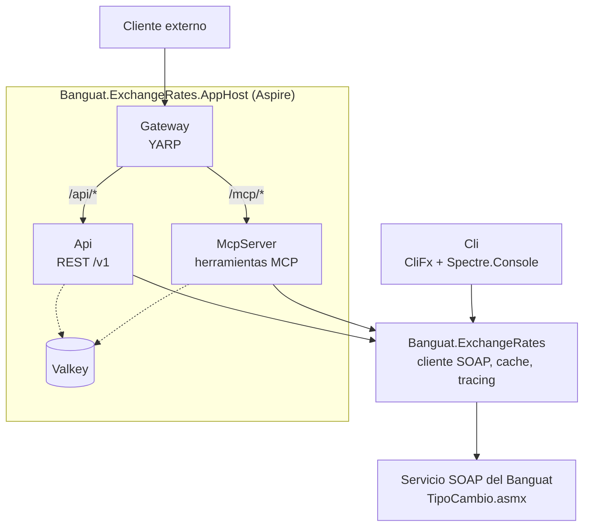

## Descripción del proyecto

Trabajar sobre una tecnología vieja no tiene por qué salir caro si la frontera entre lo viejo y lo nuevo se pone en el lugar correcto desde el principio. `Banguat.ExchangeRates` es una solución de .NET 10 que envuelve el servicio SOAP de tipo de cambio del Banco de Guatemala (`TipoCambio.asmx`) y lo expone de tres formas distintas: una API REST versionada, un servidor MCP para que agentes de IA consulten el tipo de cambio como herramientas, y un CLI para uso interactivo desde la terminal. El servicio original es un ASMX clásico: sobres XML a mano, operaciones con nombres en español (`TipoCambioDia`, `Variables`, `TipoCambioFechaInicial`, `TipoCambioRango`) y una forma de respuesta que cambia según la moneda que se consulte. La librería central (`Banguat.ExchangeRates`) es la única que habla SOAP, cachea las respuestas y las traza con OpenTelemetry, y expone un cliente tipado (`IBanguatExchangeRateClient`) del que dependen los tres consumidores.

Ni la API, ni el CLI, ni el servidor MCP hablan SOAP directamente: los tres pasan por la misma librería y el mismo pipeline de decoradores, así que un cambio en cómo se cachea o se traza una consulta se aplica igual en las tres superficies. Un gateway con YARP se sienta al frente de la API y del servidor MCP, aplica límites de tasa por dirección IP en cada ruta, y es el único punto de entrada que Aspire expone hacia afuera.

El CLI, además, sabe instalarse como una capacidad para agentes: incluye un comando `skill install` que deja una skill de Claude Code para un agente de IA que solo tenga el binario disponible, sin MCP ni acceso a internet para llegar a los docs del Banguat. Esa skill le explica al agente cómo manejar el CLI, y se instala junto con una tabla de alias de monedas generada al momento desde el mismo catálogo que el CLI resuelve internamente, así que lo que el agente lee coincide exactamente con lo que `--currency` resuelve.



## Tecnologías utilizadas

<div class="table-container">
  <table>
    <tr>
      <th>Capa</th>
      <th>Elección</th>
      <th>Por qué está en el stack</th>
    </tr>
    <tr>
      <td><strong>Runtime</strong></td>
      <td>.NET 10</td>
      <td>Target moderno con <code>DateOnly</code>, minimal APIs maduras y una línea base estable de <code>System.Text.Json</code>.</td>
    </tr>
    <tr>
      <td><strong>Cliente SOAP</strong></td>
      <td><code>System.Xml.Linq</code></td>
      <td>El servicio del Banguat es un ASMX de los 2000 sin WSDL cómodo de consumir; armar el sobre a mano con <code>XElement</code>/<code>XDocument</code> es más simple que arrastrar un generador de proxies.</td>
    </tr>
    <tr>
      <td><strong>API</strong></td>
      <td>ASP.NET Core Minimal APIs</td>
      <td>Endpoints como clases descubiertas por convención (<code>IEndpoint</code> + Scrutor), sin controladores ni atributos de ruta repartidos por todos lados.</td>
    </tr>
    <tr>
      <td><strong>Gateway</strong></td>
      <td>YARP</td>
      <td>Reverse proxy configurable en código, con transforms de ruta y resolución de destinos vía service discovery de Aspire.</td>
    </tr>
    <tr>
      <td><strong>Servidor MCP</strong></td>
      <td>ModelContextProtocol.AspNetCore</td>
      <td>Expone el mismo cliente de tipo de cambio como herramientas (<code>get_rate</code>, <code>get_currencies</code>, <code>get_rate_history</code>) que un agente de IA puede invocar directamente.</td>
    </tr>
    <tr>
      <td><strong>CLI framework</strong></td>
      <td>CliFx + Spectre.Console</td>
      <td>Comandos declarativos con inyección de dependencias, y tablas con colores para la salida interactiva.</td>
    </tr>
    <tr>
      <td><strong>Composición</strong></td>
      <td>Microsoft.Extensions.DependencyInjection + Scrutor</td>
      <td>Registro por convención de query handlers y endpoints, más decoradores (<code>Decorate&lt;T&gt;</code>) para cachear y trazar sin tocar cada handler.</td>
    </tr>
    <tr>
      <td><strong>Cache distribuido</strong></td>
      <td>Valkey (vía Aspire)</td>
      <td>Cache compartido entre la API y el servidor MCP, con duración configurable por tipo de consulta.</td>
    </tr>
    <tr>
      <td><strong>Observabilidad</strong></td>
      <td>OpenTelemetry</td>
      <td>Trazas y métricas de cada consulta al Banguat, visibles en el dashboard de Aspire durante el desarrollo local.</td>
    </tr>
    <tr>
      <td><strong>Orquestación</strong></td>
      <td>.NET Aspire 13.5</td>
      <td>Levanta Valkey, la API, el servidor MCP y el gateway juntos, con service discovery y resiliencia de HttpClient por defecto.</td>
    </tr>
    <tr>
      <td><strong>Testing</strong></td>
      <td>xUnit, NSubstitute, WebApplicationFactory, coverlet</td>
      <td>Pruebas unitarias para handlers y decoradores, además de pruebas de integración que levantan la API y el gateway completos contra un backend falso.</td>
    </tr>
  </table>
</div>

## Arquitectura

La solución tiene siete proyectos, pero solo uno habla con el Banguat. `Banguat.ExchangeRates` concentra el transporte SOAP, el parseo de cada operación, la política de cache por consulta y la instrumentación con OpenTelemetry detrás de `IBanguatExchangeRateClient`. `Banguat.ExchangeRates.Api`, `Banguat.ExchangeRates.Cli` y `Banguat.ExchangeRates.McpServer` son tres fachadas distintas sobre ese mismo cliente: ninguna referencia `System.Xml.Linq` ni conoce la forma del SOAP de abajo. `Banguat.ExchangeRates.Gateway` no conoce ninguna de las tres; solo enruta tráfico hacia la API y el servidor MCP por dirección física de red (host o contenedor), resuelta vía service discovery. `Banguat.ExchangeRates.AppHost` es el único que conoce a todos: los levanta juntos con Valkey como cache compartido.



El diagrama de arquitectura muestra qué proyecto depende de cuál. El de abajo muestra qué pasa realmente cuando alguien pide el tipo de cambio de hoy a través del gateway: la petición entra por YARP, que la reenvía a la API (o al servidor MCP) quitando el prefijo de ruta; el handler correspondiente pasa por el decorador de tracing y el de cache antes de llegar al handler real, que solo habla con el Banguat cuando el cache no tiene la respuesta.



## Decisiones de diseño

### El cliente SOAP como frontera

La primera decisión fue no dejar que el SOAP del Banguat se filtrara a ningún consumidor. En vez de generar un proxy a partir de un WSDL, armé el sobre a mano con `XElement`/`XDocument` en `BanguatSoapTransport`: son cuatro operaciones con una forma conocida de antemano, y mantener un generador de proxies hubiera sido más trabajo que escribir esos cuatro sobres directamente. La segunda decisión fue que ese transporte nunca lanza excepciones para fallas esperadas. `InvokeAsync` devuelve un `Result<XDocument>`, y un fallo de red, un XML mal formado o un SOAP fault se convierten en un `Error` con tipo (`Failure`, `Validation` o `Problem`) en vez de una excepción que cada capa de arriba tendría que atrapar por su cuenta. Con esa frontera puesta, todo lo que se construyó después (cache, tracing, API, CLI, servidor MCP) pudo ignorar por completo que el Banguat habla SOAP.

### Códigos propios del Banguat, alias en ISO 4217

El Banguat identifica cada moneda con un número interno que no sigue ningún criterio reconocible desde afuera: no es el código numérico de ISO 4217, tampoco un orden alfabético, es un correlativo que fue creciendo según cuándo se dio de alta cada moneda en su sistema. GTQ es 1, USD es 2, JPY es 3, y de ahí sigue con monedas europeas que dejaron de existir cuando llegó el euro, como el franco belga (4) o el franco suizo (5), mezcladas sin ningún patrón con monedas que sí siguen vigentes hoy. Ese número no le dice nada a nadie fuera del propio Banguat, y pedirle a cada consumidor que lo memorizara para pedir un tipo de cambio hubiera hecho que la API, el CLI y el servidor MCP fueran igual de incómodos de usar. El catálogo incluido (`BundledCurrencyAliasCatalog`) resuelve esto mapeando cada uno de esos números contra el código ISO 4217 de tres letras que ya identifica a esa moneda en cualquier otro sistema. `ICurrencyAliasCatalog` expone esa relación en los dos sentidos (`TryResolve` de alias a código, `GetAlias` de código a alias), así que tanto el CLI como el servidor MCP aceptan `usd` en vez de `2`, y la API devuelve el alias junto al código numérico en cada respuesta, sin que el número interno del Banguat deje de estar disponible para quien sí lo necesite.

### Un cliente, tres puertas de entrada

Una vez que el cliente SOAP quedó resuelto detrás de `IBanguatExchangeRateClient`, la pregunta dejó de ser cómo hablarle al Banguat y pasó a ser quién necesita este dato y de qué forma lo va a pedir. Alguien en la terminal quiere un comando rápido con salida legible. Un servicio que ya corre en producción quiere un endpoint REST versionado, cacheable y con métricas propias. Un agente de IA no quiere construir una URL ni parsear una tabla: quiere una herramienta que pueda invocar con lenguaje natural. En vez de elegir una sola forma y forzar a las demás a adaptarse, construí las tres (CliFx para el CLI, minimal APIs para la REST, `ModelContextProtocol.AspNetCore` para el servidor MCP) sobre el mismo cliente. Agregar una cuarta puerta el día de mañana significa escribir una fachada nueva, no tocar la lógica de negocio que ya existe.

### Observabilidad desde el arranque

La instrumentación con OpenTelemetry se decidió junto con el cliente, no se agregó después sobre una base que ya funcionaba a ciegas. `TracingDecorator` envuelve cada `IQueryHandler<,>` y registra una traza y una métrica por operación sin que ningún handler individual tenga que acordarse de hacerlo, y `BanguatExchangeRatesDiagnostics` expone su propio `ActivitySource` y `Meter` para que esas trazas y métricas de dominio lleguen al dashboard de Aspire igual que las de infraestructura. La severidad del log tampoco es pareja: una validación fallida, como un rango de fechas invertido, queda en `Information`; un problema del lado del Banguat, en `Warning`; y una falla de transporte real, en `Error`. Cuando algo aparece en los logs con severidad alta, significa de verdad que hay algo que atender, no que el cliente mandó un dato inválido.

## Características clave

**Cache alineado al calendario del Banguat, no a un reloj de arena.** El Banguat publica a lo sumo un tipo de cambio de referencia por día hábil, sobre el calendario civil de Guatemala (UTC-6). Por eso la expiración no es una duración rodante sino un instante absoluto: la próxima medianoche en `America/Guatemala`. `IRateCalendar` es la única fuente de esa frontera, y tanto el TTL de la entrada en Valkey como el `max-age` de la respuesta HTTP se derivan de ella, así que ambas capas vencen en el mismo momento y la obsolescencia no se apila. Cada query implementa `ICacheableQuery` y resuelve su duración contra ese calendario; un rango histórico que ya cerró se cachea largo (24 horas), y cualquier rango que todavía toca el día de hoy vence en la frontera para que mañana traiga el valor publicado hoy.

La versión anterior evaluaba esa frontera con `DateTime.UtcNow`. Como Guatemala va seis horas atrás, durante las últimas seis horas de cada día local la fecha UTC ya había cambiado, y un rango que terminaba *hoy* se clasificaba como historia cerrada y se cacheaba 24 horas. Mover la decisión al calendario de Guatemala cerró ese hueco.

**ETag y `Cache-Control` para que el cache sirva también al cliente.** Antes, el cache de Valkey era invisible por HTTP: un acierto seguía costando una petición completa a la API. Ahora un filtro de endpoint calcula un ETag fuerte a partir de los bytes exactos que se van a escribir y responde `304` ante un `If-None-Match` que coincida. Esto se combina bien con la frontera diaria: los fines de semana y feriados el Banguat no publica, así que al cruzar la medianoche el cliente revalida, el payload es idéntico byte a byte, el ETag coincide y recibe unos 150 bytes en vez del cuerpo completo. Los encabezados salen pensados para un CDN que todavía no existe pero es probable que exista: `public`, `s-maxage`, `stale-while-revalidate=60` y `stale-if-error=86400` — este último importa más de lo normal aquí, porque cuando el servicio SOAP del Banguat se cae, un cache compartido sirve el tipo de cambio de ayer en vez de propagar un 502. Las respuestas de error nunca se cachean (`no-store`), para que un 502 pasajero no se quede servido el resto del día.

**API versionada desde el día uno.** Los endpoints se registran bajo `/v1` a través de un `RouteGroupBuilder`, así que un cambio incompatible en `/currencies` o `/rates` no rompe a quien ya está integrado contra la versión anterior. El gateway no necesita saber nada de esto: su transform de `/api/*` a la raíz de la API llega igual a `/v1/*`.

**CLI con tres modos de salida y sugerencia de alias.** `--output` acepta `plain`, `rich` o `json`, así que el mismo comando sirve para leer en la terminal, para un script o para otra herramienta que parsee JSON. Si el usuario escribe mal un alias de moneda, `BanguatCommandBase` calcula la distancia de Levenshtein contra el catálogo completo y sugiere el más cercano en vez de solo decir "moneda desconocida".

**Alias de moneda personalizables por archivo.** `~/.banguat-cli/currencies.json` deja que cada quien defina sus propios alias (por ejemplo, `dolar` en vez de `usd`), y esos alias reemplazan a los del catálogo incluido en vez de apilarse sobre ellos.

**Servidor MCP con tres herramientas.** `get_currencies`, `get_rate` y `get_rate_history` exponen exactamente las mismas consultas que la API REST y el CLI, pensadas para que un agente de IA las invoque con lenguaje natural en vez de tener que construir URLs o comandos.

**El CLI instala su propia skill para agentes de IA.** `skill install --scope local|user|both` deja una skill de Claude Code para un agente que solo tenga el binario disponible, sin MCP ni acceso a internet a los docs del Banguat. Incluye el `SKILL.md`, una referencia completa de comandos y sus evals embebidos, más una tabla de alias (`known-currencies.md`) regenerada en cada `skill install` desde el mismo catálogo que el CLI resuelve internamente. Así el agente no adivina códigos: lo que lee coincide, campo por campo, con lo que `--currency` resuelve.

**Gateway como único punto de entrada externo.** YARP enruta `/api/*` hacia la API y `/mcp/*` hacia el servidor MCP. Ni la API ni el servidor MCP quedan expuestos directamente: solo el gateway tiene endpoint HTTP externo en el modelo de Aspire.

## Retos técnicos



El gateway reenviaba `/api/*` y `/mcp/*` a la API y al servidor MCP sin quitarles el prefijo, pero ninguno de los dos sirve nada bajo esas rutas, así que cada petición terminaba en 404 apenas se probaba contra la topología real.


Agregué un transform `PathRemovePrefix` a cada ruta para que el backend reciba la ruta sin el prefijo del gateway.

```csharp
new RouteConfig
{
    RouteId = "api",
    ClusterId = "api",
    Match = new RouteMatch { Path = "/api/{**catch-all}" },
    Transforms = [new Dictionary<string, string> { ["PathRemovePrefix"] = "/api" }]
}
```






Las pruebas del gateway configuraban el backend falso con `ConfigureAppConfiguration`, pero `Program.cs` lee `Destinations:*` antes de que `builder.Build()` corra, así que esa configuración nunca llegaba a tiempo. Cada petición "permitida" era en realidad un 502 silencioso contra un nombre de service discovery que no existía en el entorno de pruebas.


Cambié cada override a `builder.UseSetting`, que sí se aplica antes de que arranque el `Program` de la app. También hice que las pruebas capturaran la ruta que recibe el backend falso y afirmaran sobre ella directamente.

```csharp
await using WebApplicationFactory<Program> factory = new WebApplicationFactory<Program>()
    .WithWebHostBuilder(builder =>
    {
        builder.UseSetting("Destinations:Api", address);
    });

// ...

Assert.Equal(3, receivedPaths.Count);
Assert.All(receivedPaths, path => Assert.Equal("/currencies", path));
```






Cuando Valkey no estaba disponible, cada consulta fallida al cache registraba un `Warning` en el log. Bajo carga, eso significaba miles de líneas idénticas por minuto, suficientes para tapar cualquier otra señal útil en los mismos logs.


Agregué una muestra de una advertencia por operación (lectura o escritura) por minuto; el resto de los fallos en esa ventana se registra en `Debug`. También sumé un contador (`banguat.exchangerates.cache.lookups`) con el resultado de cada intento (hit, miss o error), para tener una señal agregada en vez de depender de contar líneas de log.

```csharp
private static void LogCacheFailure(string operationName, string operationKind, Exception ex, ILogger logger)
{
    string key = $"{operationName}:{operationKind}";
    DateTime now = DateTime.UtcNow;
    bool shouldWarn = !LastWarningLoggedAtUtc.TryGetValue(key, out DateTime last)
                      || now - last >= WarningSampleInterval;

    if (shouldWarn)
    {
        LastWarningLoggedAtUtc[key] = now;
        logger.LogWarning(ex, "Cache {OperationKind} failed for {Operation}", operationKind, operationName);
    }
    else
    {
        logger.LogDebug(ex, "Cache {OperationKind} failed for {Operation}", operationKind, operationName);
    }
}
```






La operación `Variables` del Banguat devuelve un par compra/venta real para casi todas las monedas, pero para el dólar la respuesta viene en una forma distinta (`CambioDolar`/`VarDolar`) que solo trae una tasa de referencia única. Modelar el dólar aparte habría obligado a la API, al CLI y al servidor MCP a manejar ese caso especial cada uno por su cuenta.


Dejé la normalización en un solo lugar: el parser de `GetCurrentRate`. Cuando la respuesta trae `Vars` (compra/venta), los mapea directo; cuando cae al formato de dólar (`CambioDolar`), duplica la tasa de referencia en `Buy` y en `Sell`. Así `RatePoint` siempre tiene la misma forma para cualquier moneda, y ningún consumidor necesita saber que el dólar es distinto por debajo.

```csharp
/// <summary>
/// For USD, the live service returns a single reference rate rather than a bid/ask spread —
/// in that case Buy and Sell are both set to that same reference rate. For every other
/// currency, Buy and Sell are the service's actual buy/sell quote.
/// </summary>
public sealed record RatePoint(DateOnly Date, decimal Buy, decimal Sell);
```




## Lo que este proyecto demuestra

<div class="table-container">
  <table>
    <tr>
      <th>Área</th>
      <th>Evidencia</th>
    </tr>
    <tr>
      <td><strong>Manejo de errores sin excepciones</strong></td>
      <td><code>Result</code>/<code>Error</code> tipados en <code>Common/</code>, usados de punta a punta desde el transporte SOAP hasta cada endpoint, comando de CLI y herramienta MCP.</td>
    </tr>
    <tr>
      <td><strong>Decoradores por convención</strong></td>
      <td>Scrutor registra cada <code>IQueryHandler&lt;,&gt;</code> por escaneo y los envuelve con <code>TracingDecorator</code> y <code>CachingDecorator</code> sin tocar el código de cada handler.</td>
    </tr>
    <tr>
      <td><strong>Múltiples fachadas sobre un mismo core</strong></td>
      <td>La API REST, el CLI y el servidor MCP comparten <code>IBanguatExchangeRateClient</code>; ninguno referencia <code>System.Xml.Linq</code> ni conoce el SOAP de abajo.</td>
    </tr>
    <tr>
      <td><strong>El CLI se instala como skill</strong></td>
      <td><code>skill install</code> combina los archivos de skill embebidos como recursos con una tabla de alias generada al momento desde <code>ICurrencyAliasCatalog</code>, de modo que el agente de IA lee exactamente lo que <code>--currency</code> resuelve internamente.</td>
    </tr>
    <tr>
      <td><strong>Gateway con YARP</strong></td>
      <td>Transforms de ruta por prefijo, resolución de destinos vía service discovery de Aspire y límites de tasa particionados por IP en <code>Banguat.ExchangeRates.Gateway</code>.</td>
    </tr>
    <tr>
      <td><strong>Orquestación con Aspire 13.5</strong></td>
      <td><code>AppHost.cs</code> declara Valkey, la API, el servidor MCP y el gateway como recursos con sus referencias explícitas; <code>ServiceDefaults</code> centraliza health checks, resiliencia de HttpClient y OpenTelemetry.</td>
    </tr>
    <tr>
      <td><strong>Observabilidad de dominio</strong></td>
      <td><code>BanguatExchangeRatesDiagnostics</code> expone su propio <code>ActivitySource</code> y <code>Meter</code>, registrados a mano en cada host porque <code>ServiceDefaults</code> solo instrumenta el <code>ActivitySource</code> nombrado como la app misma.</td>
    </tr>
    <tr>
      <td><strong>Testabilidad</strong></td>
      <td>xUnit y NSubstitute para handlers y decoradores; <code>WebApplicationFactory</code> con un backend HTTP falso para probar el gateway y la API de punta a punta, incluyendo particionamiento de límites de tasa por IP.</td>
    </tr>
  </table>
</div>

## Resultados

<div class="table-container">
  <table>
    <tr>
      <th>Resultado</th>
      <th>Evidencia</th>
    </tr>
    <tr>
      <td><strong>Una sola fuente de verdad para tres audiencias distintas</strong></td>
      <td>Una persona en la terminal, una aplicación consumiendo REST y un agente de IA usando MCP obtienen exactamente el mismo dato, con la misma política de cache y de errores detrás.</td>
    </tr>
    <tr>
      <td><strong>El servicio legado queda encapsulado</strong></td>
      <td>Ningún consumidor conoce los nombres en español de las operaciones SOAP ni la forma distinta que toma la respuesta del dólar; todo eso vive en un solo proyecto.</td>
    </tr>
    <tr>
      <td><strong>El gateway protege a los backends</strong></td>
      <td>La API y el servidor MCP no tienen endpoint externo propio en Aspire; solo el gateway lo tiene, con límites de tasa por cliente ya aplicados antes de que la petición los alcance.</td>
    </tr>
    <tr>
      <td><strong>Los bugs de integración se atraparon en pruebas, no en producción</strong></td>
      <td>El bug de <code>ConfigureAppConfiguration</code> que dejaba pasar peticiones permitidas por un 502 silencioso se encontró y se corrigió antes de llegar a un entorno real.</td>
    </tr>
    <tr>
      <td><strong>La API está versionada desde el primer commit del endpoint</strong></td>
      <td><code>/v1</code> da margen para cambios futuros sin romper a quien ya integró contra la API, y el gateway no necesita ningún cambio para seguir enrutando correctamente.</td>
    </tr>
  </table>
</div>

## Enlaces

- Repositorio: banguat
- Servicio SOAP del Banguat: TipoCambio.asmx
- .NET Aspire: learn.microsoft.com/dotnet/aspire
- YARP: microsoft.github.io/reverse-proxy
- Model Context Protocol: modelcontextprotocol.io

---

<!-- TODO: reemplazar con foto de portada real y su crédito antes de publicar -->
